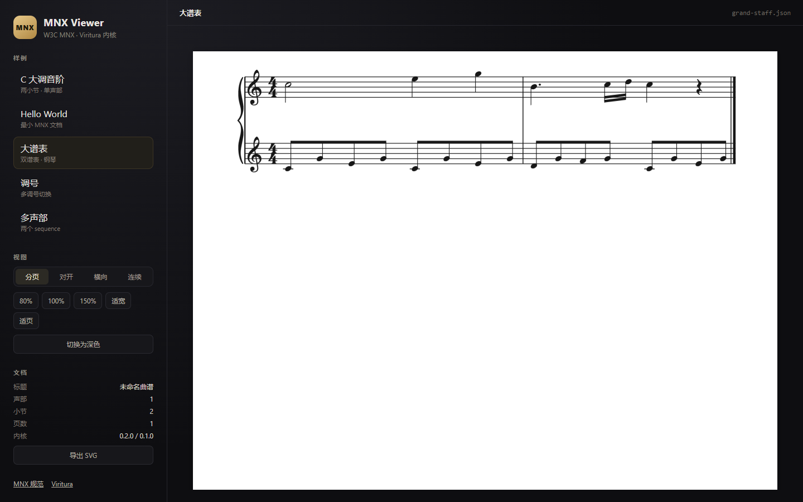

# @quincyx/vue-mnx-viewer

W3C [MNX](https://w3c-cg.github.io/mnx/) 曲谱的 Vue 3 渲染组件。底层直接使用
[`@viritura/score-engine`](https://www.npmjs.com/package/@viritura/score-engine)（Rust/WASM 排版）与
[`@viritura/score-viewer`](https://www.npmjs.com/package/@viritura/score-viewer)（分页、缩放、滚动、播放头）。
本项目只负责 Vue 封装、运行时资源同步与演示，**没有重写排版或绘谱逻辑**。



## 安装

```bash
npm install @quincyx/vue-mnx-viewer
# 或 pnpm add @quincyx/vue-mnx-viewer
```

要求 Vue `^3.5`。`@viritura/*` 会作为本包依赖自动安装，请勿再单独安装其他版本。

## 快速开始

```ts
// vite.config.ts
import { defineConfig } from 'vite'
import vue from '@vitejs/plugin-vue'
import { scoreEngineAssets } from '@quincyx/vue-mnx-viewer/vite'

export default defineConfig({
  plugins: [vue(), scoreEngineAssets()],
})
```

```vue
<script setup lang="ts">
import { shallowRef } from 'vue'
import { MnxViewer } from '@quincyx/vue-mnx-viewer'
import type { MnxSource } from '@quincyx/vue-mnx-viewer'
import '@quincyx/vue-mnx-viewer/style.css'

const mnx = shallowRef<MnxSource>(null)
</script>

<template>
  <div class="score-stage">
    <MnxViewer
      :mnx="mnx"
      view-mode="page"
      zoom="fit-width"
      page-background="#fffdf9"
      ink="#17130e"
      @ready="({ engine }) => console.log(engine.version)"
      @error="(error) => console.error(error)"
    />
  </div>
</template>

<style>
.score-stage {
  height: 80vh;
  min-height: 0;
}
</style>
```

宿主容器必须有确定高度（例如 `height: 80vh`，且祖先 `min-height: 0`），查看器会在容器内部滚动。
发布包把组件样式提取为 `dist/style.css`，使用时需要显式 `import '@quincyx/vue-mnx-viewer/style.css'`
（工作区内直接消费 `src/` 时会自动带入）。

### 运行时资源

引擎从 `assetBaseUrl` 加载 `wasm/`、`fonts/` 和 `score-engine.worker.js`，打包器无法推断这些 URL。
`scoreEngineAssets()` 会在 Vite 启动/构建时把 `@viritura/score-engine/dist` 下的运行时文件复制到
`<publicDir>/score-engine`，与组件默认的 `assetBaseUrl: '/score-engine/'` 配套。

- 自定义目录：`scoreEngineAssets({ target: 'assets/mnx-engine' })`，同时传入 `:asset-base-url="'/assets/mnx-engine/'"`。
- 资源目录是生成物，应加入 `.gitignore`；不要手工拷贝或提交。

### Props

| 属性 | 默认值 | 说明 |
| --- | --- | --- |
| `mnx` | — | MNX JSON 字符串或对象；`null` 显示空态 |
| `viewMode` | `page` | `page` / `spread` / `horizontal` / `spread-horizontal` / `horizon` |
| `zoom` | `fit-width` | 数字、`fit-width`、`fit-page` |
| `pageWidth` / `pageHeight` / `spatium` | 引擎默认 | 排版参数 |
| `pageBackground` / `ink` / `background` | 白纸黑墨 | 纸面、墨色与容器底色 |
| `assetBaseUrl` | `/score-engine/` | 引擎运行时资源目录 |
| `useWorker` | `false` | 在 Worker 中排版 |
| `playhead` | `null` | `{ beat }` 或 `{ measureIndex, beat }`，可带 `follow` |
| `height` | `100%` | 组件根节点高度 |
| `label` | `曲谱` | 无障碍名称 |

事件：`ready({ engine, displayList })`、`layout({ measurements, pageCount })`、`error(Error)`。

### 暴露方法

通过模板 ref 调用：

`zoomTo()`、`fitWidth()`、`fitPage()`、`scrollToPosition()`、`toSvg(page)`、`getEngine()`、`getDisplayList()`。

```ts
const viewer = useTemplateRef<MnxViewerExposed>('viewer')
const svg = await viewer.value?.toSvg(0)
```

## 演示数据

`@quincyx/vue-mnx-viewer/samples` 导出 5 个 W3C MNX 官方示例（`demoScores`），用于无后端演示。
它们不是生产内容，接入 API 后应被真实曲谱替换。

## 版本策略

`@viritura/score-engine` 处于 `0.x`，上游明确提示可能破坏兼容。本包锁定 **0.2.0**，
`@viritura/score-viewer` 锁定 **0.1.1**；升级必须同步验证渲染、播放头与 SVG 导出，并记录到
[docs/changelog.md](./docs/changelog.md)。

## 本地开发

```bash
pnpm install
pnpm dev          # 试验场 http://localhost:5180
pnpm test         # mnx 解析与示例数据单测
pnpm type-check   # vue-tsc
pnpm build:lib    # 构建 dist/（JS + 类型 + CSS）
```

## 发布

```bash
pnpm build:lib
npm publish --access public
```

发布前确认 `package.json` 的 `version` 已递增；`prepublishOnly` 会自动重新构建。
GitHub 仓库：<https://github.com/QuincyX/vue-mnx-viewer>。

## 边界

- 只接受 MNX；MusicXML 转换属于使用方（例如 `mnxconverter`），不属于渲染器。
- 不提供编辑交互；命中测试（`canvasToBeat`）等能力可由使用方直接调用暴露的 engine。
- 只面向桌面浏览器；不承诺窄屏布局。

## License

[MIT](./LICENSE)
